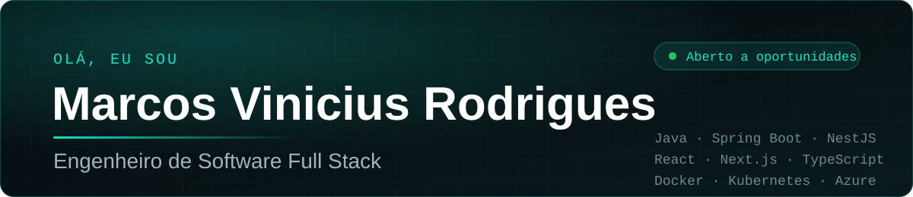
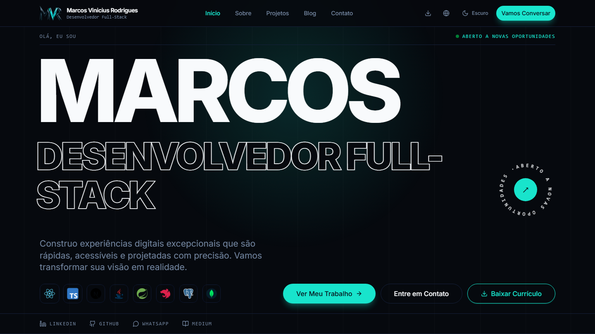

---

## 👨‍💻 Sobre mim

Engenheiro de Software com mais de 5 anos de experiência, atuando no front-end (React, TypeScript, Next.js) e no back-end (Java, Spring Boot, NestJS). Construo soluções escaláveis e de alta performance, com foco em Clean Code, testes automatizados e observabilidade. Gosto de aprender tecnologias novas, melhorar processos e entregar resultado.

---

## 🚀 Portfólio

  

Meu portfólio reúne projetos, blog e formas de contato, e tem o currículo para baixar.

👉 **[marcos-vinicius-rodrigues.com.br](https://marcos-vinicius-rodrigues.com.br)**

---

## 📊 Atividade

  

  <picture>
    <source media="(prefers-color-scheme: dark)" srcset="https://raw.githubusercontent.com/MarcosViniciusRodriguesEngSoft/MarcosViniciusRodriguesEngSoft/output-games/pacman-contribution-graph-dark.svg" />
    
  </picture>

---

## 💻 Tech Stack

<table>
  <tr>
    <td><b>Frontend</b></td>
    <td>
      
      
      
      
      
      
    </td>
  </tr>
  <tr>
    <td><b>Backend</b></td>
    <td>
      
      
      
      
    </td>
  </tr>
  <tr>
    <td><b>Bancos de dados</b></td>
    <td>
      
      
      
      
    </td>
  </tr>
  <tr>
    <td><b>Testes</b></td>
    <td>
      
      
      
      
    </td>
  </tr>
  <tr>
    <td><b>DevOps & Cloud</b></td>
    <td>
      
      
      
      
      
      
    </td>
  </tr>
  <tr>
    <td><b>Observabilidade</b></td>
    <td>
      
      
      
    </td>
  </tr>
  <tr>
    <td><b>Mensageria</b></td>
    <td>
      
    </td>
  </tr>
  <tr>
    <td><b>Inteligência Artificial</b></td>
    <td>
      
      
      
      
    </td>
  </tr>
  <tr>
    <td><b>Versionamento</b></td>
    <td>
      
      
      
      
      
    </td>
  </tr>
  <tr>
    <td><b>Ferramentas</b></td>
    <td>
      
      
      
      
      
    </td>
  </tr>
</table>

---

### 👀 Visitantes do Perfil

### 👥 Seguidores & Seguindo

