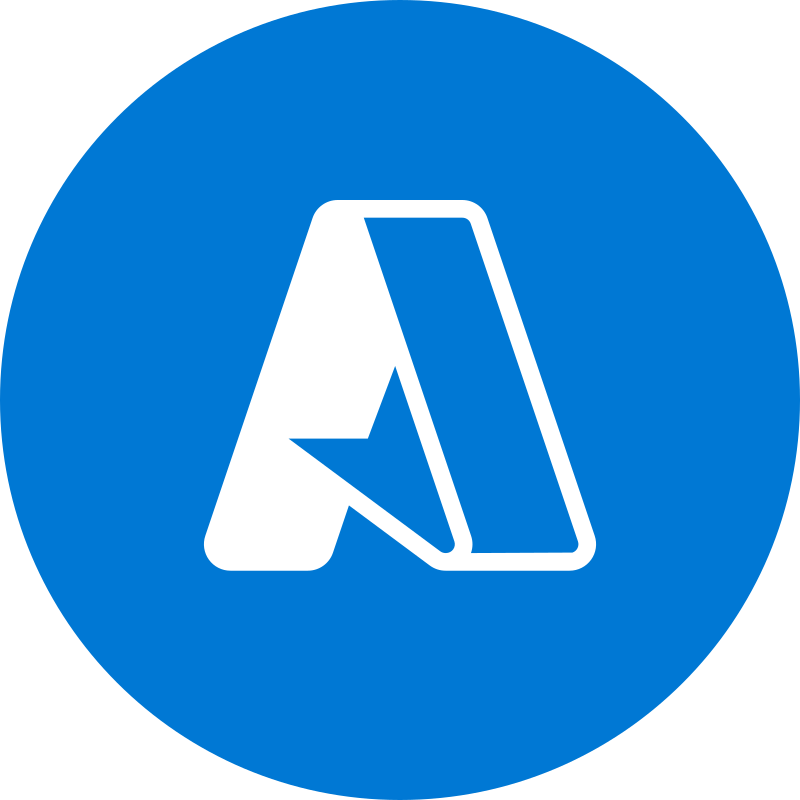

<h1>Olá, eu sou Marcos Vinicius Rodrigues 👋</h1>
<h3>Desenvolvedor Full Stack · Java · TypeScript · Cloud</h3>

    

📧 marcos.vinicius.engsof@gmail.com 
📱 +55 (44) 99820-4407 &nbsp;·&nbsp; 📍 Sarandi, Paraná

---

## 👨‍💻 Sobre mim

Engenheiro de Software com mais de 4 anos de experiência, atuando no front-end (React, TypeScript, Next.js) e no back-end (Java, Spring Boot, NestJS). Construo soluções escaláveis e de alta performance, com foco em Clean Code, testes automatizados e observabilidade. Gosto de aprender tecnologias novas, melhorar processos e entregar resultado.

---

## 💼 Experiência

**Desenvolvedor Full Stack · Grupo Irrah** Maringá, PR · fev 2025 – atual
- Microsserviços com Redis Cache e Apache Pulsar, APIs com MongoDB e observabilidade com Grafana.
- Corrigi um bug crítico em Kubernetes que reiniciava pods em loop, com ganho de cerca de 70% em performance e consistência.
- Refatorei um sistema legado com Separation of Concerns e Clean Code.
- Implantei testes com Jest no front-end e o SonarQube para qualidade de código e débito técnico.

**Desenvolvedor Full Stack · Happy** Maringá, PR · jan 2022 – jan 2025
- Aplicações web com React/TypeScript e APIs REST em Java e Spring Boot, com SQL Server e rotinas agendadas.
- Integrações com WhatsApp, OneSignal, Pagar.me, eNotas, Zapsign, entre outras.
- Componentes reutilizáveis e bibliotecas internas; Scrum e Kanban; atuação como Product Owner.

**Analista de Desenvolvimento de Sistemas · Happy** Maringá, PR · nov 2021 – jan 2022
- Suporte técnico a mais de 60 unidades, gestão de chamados no GLPI e relatórios customizados em SQL.

---

## 🎓 Formação

- **Bacharelado em Engenharia de Software** · Unicesumar · 2019 – 2023
- **Pós-graduação em Desenvolvimento de Sistemas com Java** · Unicesumar · 2023 – 2024
- **Idiomas:** português (nativo) e inglês (técnico)

---

## 📊 GitHub Stats

  

    
    
  

  

    
  

---

## 💻 Tech Stack

<table>
  <tr>
    <td><b>Frontend</b></td>
    <td>
      
      
      
      
      
      
    </td>
  </tr>
  <tr>
    <td><b>Backend</b></td>
    <td>
      
      
      
      
    </td>
  </tr>
  <tr>
    <td><b>Bancos de dados</b></td>
    <td>
      
      
      
      
    </td>
  </tr>
  <tr>
    <td><b>Testes</b></td>
    <td>
      
      
      
      
    </td>
  </tr>
  <tr>
    <td><b>DevOps & Cloud</b></td>
    <td>
      
      
      
      
      
      
    </td>
  </tr>
  <tr>
    <td><b>Observabilidade</b></td>
    <td>
      
      
      
    </td>
  </tr>
  <tr>
    <td><b>Mensageria</b></td>
    <td>
      
    </td>
  </tr>
  <tr>
    <td><b>Inteligência Artificial</b></td>
    <td>
      
      
      
      
    </td>
  </tr>
  <tr>
    <td><b>Versionamento</b></td>
    <td>
      
      
      
      
      
    </td>
  </tr>
  <tr>
    <td><b>Ferramentas</b></td>
    <td>
      
      
      
      
      
    </td>
  </tr>
</table>

---

### 👀 Visitantes do Perfil

### 👥 Seguidores & Seguindo

---

<picture>
  <source media="(prefers-color-scheme: dark)" srcset="https://raw.githubusercontent.com/MarcosViniciusRodriguesEngSoft/MarcosViniciusRodriguesEngSoft/output-games/pacman-contribution-graph-dark.svg" />
  
</picture>
